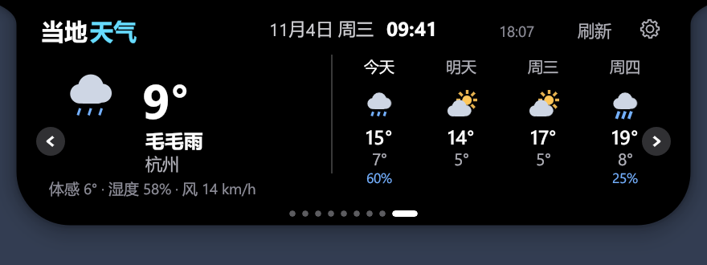
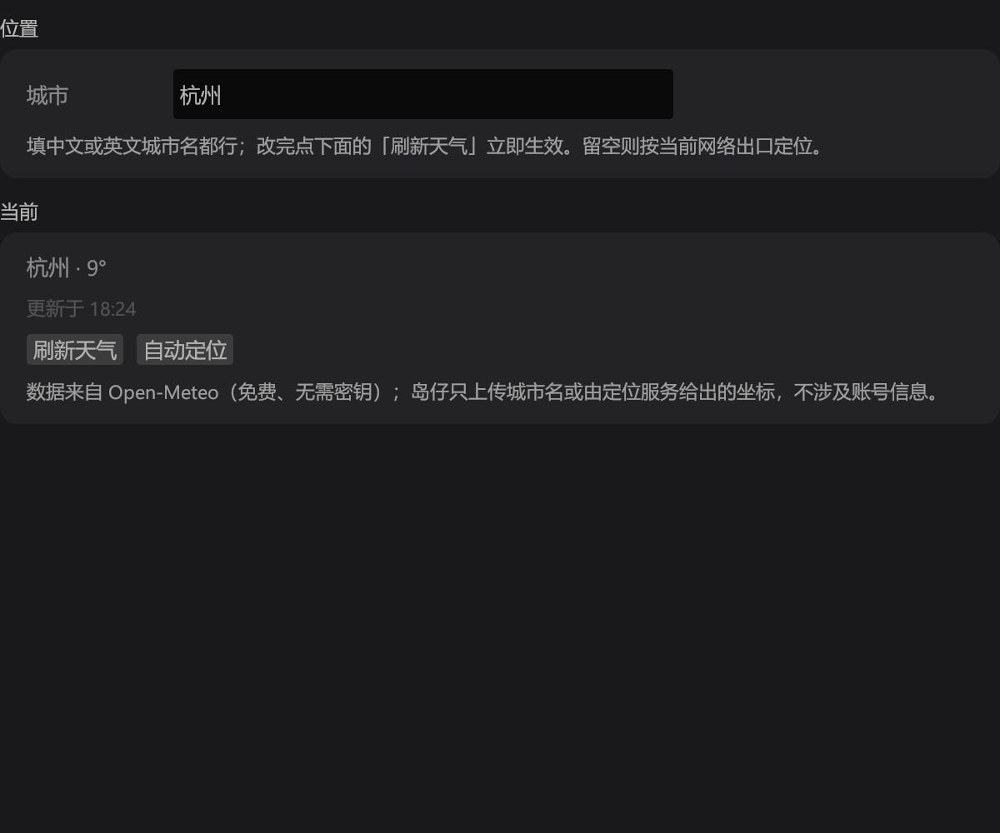

# 【功能建议】新增「天气」版块：当地实况 + 四日预报

> 建议类型：功能新增（新增第 9 个页面 + 设置项「天气」）
> 状态：已有一份在本机跑通的完整实现（`src/weather.rs` + `src/weather_ui.rs`），可直接整理成 PR

## 背景

岛仔现在管着消息、音乐、日程和 AI 额度，但这些信息里少了一件每天出门前都要确认的事——天气。它常驻在屏幕最上层、一眼就能看到，天生适合放「现在几度、要不要带伞」这种一次只读一眼的短信息。

岛上顶栏的日期与时钟已经有了，温度是顺理成章的延伸：不用切窗口、不用掏手机，抬眼就能看到。

目前社区里已有 `[功能]` 类建议若干（置顶、云同步、周期提醒等），天气尚未有人提过，检索 `weather` / `天气` 无重复 issue。

---

## 一、页面设计

### 布局

沿用现有页面的卡片语言：左侧「当下」，右侧「往后四天」，中间一条竖分隔线。

```
┌──────────────────────────────────────────────────────────────┐
│  当地 天气              11月4日 周三  09:41   18:07  刷新  ⚙  │
│                                                              │
│      ☁☂        9°   │   今天    明天    周三    周四          │
│                     │   ☁☂     ⛅      ⛅      ☁☂           │
│    毛毛雨            │   15°     14°     17°     19°          │
│    杭州              │    7°      5°      5°      8°          │
│                     │   60%                      25%          │
│  体感 6° · 湿度 58% · 风 14 km/h                              │
│                                                              │
│                      ● ● ● ● ● ● ● ● ●                       │
└──────────────────────────────────────────────────────────────┘
```

- **左区**：矢量天气图标（42px）+ 温度（30pt，取整显示，不带小数）+ 天气现象文案 + 城市名；底部一行 meta 只显示服务端真给了值的字段（体感 / 湿度 / 风速），缺哪个就少显示哪个，不留空占位。
- **右区**：四列预报，标签为「今天 / 明天 / 周三 / 周四」，每列从上到下是图标、最高温（粗）、最低温（弱）、降水概率（**≥20% 才显示**，避免干燥天满屏 0%）。
- **顶栏右侧**：「刷新」热区位于返回音乐与设置按钮左侧；加载中时文案变「更新中」并置灰。更新时间位于右下方来源链接旁。
- **左右翻页箭头**：天气页内容比其它页高，箭头纵向位置单独调整为 `arrow_y = 88`，避免压住 meta 行。

### 截图

| 天气页 | 设置 → 天气 |
| --- | --- |
|  |  |

> 两张图均为无窗口测试宿主导出的真实渲染结果（非手绘稿）。提交 issue 时需要把 `docs/issue-assets/` 下两张图拖进编辑框。

### 空状态 / 异常态

不联网或不给定位权限是常态，所以三种状态都有明确文案，不做空白页：

| 状态 | 左侧主文案 | 副文案 |
| --- | --- | --- |
| 首次加载 | 正在获取当地天气… | — |
| 拿不到数据 | 天气暂时取不到 | 点右上「刷新」重试 / 在设置里填写城市 |
| 有缓存但已过期 | 正常显示旧数据 | 顶部时间戳 + 「上次更新 18:07」提示 |

---

## 二、数据源选型

| 方案 | 密钥 | 中国大陆直连 | 数据质量 | 结论 |
| --- | --- | --- | --- | --- |
| **Open-Meteo** | 不需要 | ✅ 实测可直连 | WMO code + 逐时/逐日，多模式融合 | **采用** |
| wttr.in | 不需要 | ⚠️ 时快时慢 | 聚合第三方，字段粗糙 | 备选 |
| 和风天气 QWeather | 需注册 key | ✅ | 国内最准 | 需用户填 key，与「开箱即用」冲突 |
| 彩云天气 | 需申请 key 与商业授权 | ✅ | 分钟级降水强 | 同上，且授权流程更重 |
| 中国天气网 | 无公开 API | — | — | 不可行 |

选 Open-Meteo 的决定性原因是**零配置**：岛仔的既有设计是「装好就能用」，让用户为了看个天气去注册开发者账号拿 key 会直接把功能门槛抬到没人用。

许可方面需要注意：Open-Meteo 的数据为 CC BY 4.0，免费额度面向非商业用途（具体条款以官网为准）。岛仔是开源免费软件，属非商业用途，但**必须署名**——天气页和设置页提供 Open-Meteo 来源链接，设置页同时提供 CC BY 4.0 许可链接；数据处理方式与许可链接记录在 `THIRD_PARTY_NOTICES.txt`。

---

## 三、定位策略（这里有个刻意设计）

天气接口要的是经纬度，但「我在哪」这件事有两种拿法，取舍不同：

- **直接信 IP 库给的经纬度**：省一次请求，但 IP 定位的坐标误差经常是几十公里甚至跨市（尤其移动网络、企业出口），落到隔壁城市的格点上就会明显不准。
- **只用 IP 库给的城市名，再拿城市名去查天气**：多一次 geocoding 请求（几十毫秒、同一个域名体系），但结果和用户心里「我在杭州」一致得多。

**当前实现采用前者**：自动定位使用 `ipwho.is` 返回的坐标查询天气，城市名用作显示标签。用户手动确认城市后，才使用 Open-Meteo geocoding 解析坐标；网络出口位置不准确时可以手动指定城市。

定位服务的实测淘汰过程（都可以少踩一遍）：

| 服务 | 问题 |
| --- | --- |
| `ipapi.co` | 国内访问被 Cloudflare 拦（403 / challenge） |
| `ip-api.com` | 免费版只给 HTTP，没 HTTPS，桌面端不该为这个降级 |
| **`ipwho.is`** | ✅ HTTPS + `?lang=zh-CN` 直接返回中文城市名 |

本机实测（出口 IP 在湖北）定位结果为「武汉」，与运营商出口归属一致。

用户手动填城市时走 geocoding 的 `name` 查询，中英文都支持（`language=zh` 让返回名是中文），填「杭州」「Hangzhou」都能命中；查不到时提示「没找到「XX」这个城市」，不静默失败。

---

## 四、接口细节

### 1. 实况 + 预报

```
GET https://api.open-meteo.com/v1/forecast
```

| 参数 | 值 |
| --- | --- |
| `latitude` / `longitude` | 保留 4 位小数 |
| `current` | `temperature_2m,relative_humidity_2m,apparent_temperature,is_day,weather_code,wind_speed_10m` |
| `daily` | `weather_code,temperature_2m_max,temperature_2m_min,precipitation_probability_max` |
| `timezone` | `auto`（关键：否则返回 UTC，日期会错一天） |
| `forecast_days` | `4` |

`is_day` 必须取——同一个 `weather_code = 0`，白天要画太阳、夜里要画月亮。

### 2. 城市名 → 坐标

```
GET https://geocoding-api.open-meteo.com/v1/search?name=杭州&count=1&language=zh&format=json
```

取 `results[0]` 的 `latitude` / `longitude` / `name`。

### 3. IP 定位

```
GET https://ipwho.is/?lang=zh-CN
```

取 `latitude` / `longitude` 作为自动查询坐标；显示名称取 `city` → 回退 `region` → 回退 `country`。`success == false` 时提示用户手填城市。

### 4. WMO 天气代码 → 图标 / 文案

接口返回的是 WMO 4677 数字码，需要映射成 10 种图标和中文描述：

| code | 图标 | 文案 |
| --- | --- | --- |
| 0 | 太阳 / 月亮（按 `is_day`） | 晴 |
| 1 / 2 | 太阳+云 | 晴间多云 / 多云 |
| 3 | 云 | 阴 |
| 45 / 48 | 雾 | 雾 |
| 51 / 53 / 55 / 56 / 57 | 细雨 | 毛毛雨 / 小雨 / 细雨 / 冻雨 |
| 61 / 63 / 65 / 66 / 67 | 雨 | 小雨 / 中雨 / 大雨 / 冻雨 |
| 71 / 73 / 75 / 77 / 85 / 86 | 雪 | 小雪 / 中雪 / 大雪 / 米雪 / 阵雪 / 强阵雪 |
| 80 / 81 / 82 | 阵雨 | 阵雨 / 强阵雨 / 暴雨 |
| 95 / 96 / 99 | 闪电 | 雷阵雨 / 雷暴伴冰雹 |

图标全部用 `Card` 矢量绘制（圆 + 多边形 + 线段拼），**不引入任何 PNG / 字体图标**，这样在 125% / 150% 缩放下不会模糊，也不会把 exe 撑大。

---

## 五、刷新与降级

| 项 | 值 | 理由 |
| --- | --- | --- |
| 自动刷新间隔 | 900s（15 分钟） | Open-Meteo 的实况本身就 15 分钟一档，刷更勤没有新数据 |
| 成功后冷却 | 30s | 防手抖连点「刷新」把免费额度打爆 |
| 失败后冷却 | 120s | 断网时不至于每次 tick 都发请求卡住 |
| 请求超时 | 12s | 与项目内其它网络请求一致 |
| 缓存 | `%APPDATA%\Daozai\weather.json` | 只存最近一次快照，冷启动先显示旧数据再后台更新 |

取数走后台线程 + `mpsc` 轮询（与 `quota` 模块同构），**绝不在渲染线程里发网络请求**，避免断网时界面卡死。

城市输入保留为草稿，按回车或点「刷新天气」才应用。确认其他城市后可以立即查询；同一城市的手动与自动刷新共用请求间隔限制。关闭天气模块后不再启动新查询，已关闭模块或城市已变更的在途结果不更新界面与缓存。

---

## 六、接入现有架构的改动面

岛仔的页面是固定长度数组，加一页要动的地方比较分散，列出来方便评估：

| 位置 | 改动 |
| --- | --- |
| `PAGE_NAMES` | `[&str; 8]` → `[&str; 9]`，末尾加 `"天气"` |
| `Settings::visible_pages` / `page_order` | `[bool; 8]` → `[bool; 9]`、`[usize; 8]` → `[usize; 9]` |
| `App::dots` | `[Spring; 8]` → `[Spring; 9]` |
| 页面分发 | `8 => self.page_weather(...)` |
| 标题 | `8 => ("当地", "天气", theme::CYAN)` |
| 设置跳转表 | `[1,2,3,5,4,7,11,8,12]`（新增 `12` 指向天气设置） |
| `SETTINGS_GROUPS` | 加 `("天气", 12, 12)`，侧栏第 13 项 |
| `Settings::weather_city` | 新字段，默认空串（= 自动定位） |
| `bar_layout::WEATHER` | 常驻胶囊新增天气槽（用原本空闲的槽位 5），紧贴时钟右侧，与时钟成组、不参与排序 |
| `Layout::widen` | 抽出通用的槽位加宽方法，点数文字、时段时钟、天气温度共用 |

### 向后兼容

老用户的配置文件里只有 8 页的顺序和可见性掩码，升级后如果直接按 9 页解析会整段失效。所以 `model::load` 里做了迁移：

- `visible_pages`：接受 6~9 位，缺的位补 `true`（新页面默认可见，符合预期）
- `page_order`：8 项且恰好是 0..8 的一个排列时，追加 `8` 到末尾
- 其余字段解析逻辑不动，`weather_city` 缺失时用空串

已用 `v0649_settings_and_mail_accounts_survive_upgrade` 这类升级测试覆盖：老配置读入后原有设置全部保留、天气页按默认值出现。

---

## 七、隐私

- 只向 Open-Meteo 发经纬度（或用户手填的城市名），自动定位时会查询 `ipwho.is` 的网络出口位置，都是无账号的公开接口。
- 不读取任何登录态、不上报设备标识；`weather.json` 只存本地用于离线展示。
- README 与 `docs/PRIVACY.md` 说明天气接口、自动定位和本地缓存。

---

## 八、验证情况

已在本机（Windows 11 + Rust stable-msvc）跑通：

- `cargo check --locked --all-targets` 通过，天气模块 **0 警告**
- 全量 `cargo test --locked --lib -- --test-threads=1`：**774 passed / 0 failed / 89 ignored**
  - 天气相关共 10 个用例（8 通过 / 2 忽略）：数据层 6 个（实况+四日解析、缺温度报错、WMO 码映射、15 分钟过期判定、改城市触发新请求、时间格式化）、页面级 UI 回归 2 个（数据齐全时的排版 / 无数据时的空状态文案）、手动预览探针 2 个
  - 常驻徽标 2 个 UI 回归：温度在时钟右侧且不重叠、点温度进天气页；无数据 / 隐藏天气页不占位
  - 布局 3 个单测：天气紧跟时钟、自定义排序下仍成组、加宽后不与其它组件重叠（含全组合遍历，`weather` 开关一起纳入）
- `cargo build --locked --bin daozai` 成功
- 真实联网探针（`#[ignore]` 手动跑）：
  - 自动定位 → 武汉，10.1°，`code=3`（阴），四日 `12.2/7.2`、`13.5/6.2`、`16.1/7.8`、`15.5/10.4`（末两日 56% 降水）
  - 手填「杭州」→ 9.2°，与手机天气应用一致

测试环境不联网：`weather_tick()` 正常执行模块开关、结果丢弃与刷新判定，仅在 `cfg!(test)` 下跳过实际网络请求；测试自行注入 `Snapshot`，所以 UI 测试结果稳定、不依赖外网。

---

## 九、实现清单

```
新增  src/weather.rs                          数据层：定位、geocoding、取数、解析、缓存、冷却
新增  src/weather_ui.rs                       界面层：页面渲染、矢量图标、设置页
新增  assets/settings-icons/system/weather.svg 设置侧栏图标（蓝色渐变圆角底 + 白色太阳云，与既有图标同风格）
改动  src/app.rs                             页面注册、跳转表、标题、tick 挂载、箭头位置、常驻徽标布局与绘制
改动  src/bar_layout.rs                      天气槽位、通用加宽、时钟成组排序、布局测试
改动  src/resident_settings.rs               设置页常驻排列预览带上天气徽标
改动  src/model.rs                           weather_city 字段、数组扩到 9、旧配置迁移
改动  src/extras.rs                          设置分组、侧栏图标、页面描述
改动  src/lib.rs                             模块注册
改动  src/ui_tests.rs                        9 页断言更新 + 新测试
改动  README.md / CHANGELOG.md               功能说明与隐私说明
```

---

## 十、常驻胶囊上的温度

岛上收起时，时间后面紧跟一枚天气徽标：迷你矢量图标 + 当前温度（`⛅ 9°`），点一下直接打开天气页，悬浮显示「城市 · 天气现象 · 更新于 HH:MM」。

几个实现上的取舍：

- **不占用户排序**：`resident_order` 只排电池 / 吉祥物 / 时钟 / 额度 / 音乐 / 专注六项，天气固定粘在时钟右边、跟着时钟一起被拖动，所以没给设置页加新的拖拽项。
- **宽度自适应**：`-12°` 这类更长的温度会把槽位撑宽，其余组件对称让位，不会压到旁边的额度环。
- **不显示的条件**：没有数据、用户隐藏了天气页、或进了极简模式时不占位（否则细条上会留一段空白）。
- **提示框不能用 `on_hover_text`**：常驻胶囊上的悬浮层会盖住指针，把按下那一帧的命中抢走，导致点不动。项目里已有的 `bar_tooltip` 就是为此写的（延迟 0.5 秒、按下时不弹、`interactable(false)`），天气徽标复用它。
- 数据超过半小时没更新时温度转灰，和额度徽标的过期处理一致。

## 十一、可选扩展（本次未做）

1. **天气页内左滑切城市**：现在改城市要去设置里填，常用两三个城市的人会嫌麻烦。
2. **极端天气提醒**：降水概率 / 大风超阈值时在岛上闪一次提示。
3. **侧边停靠模式**：竖向停靠时的时间列暂未加天气，只处理了顶部/底部停靠的横向胶囊。

---

*如果你认可这个方向，我可以把上面这套实现整理成 PR（含单元测试与 UI 回归测试，已在本机全量跑通）。*
